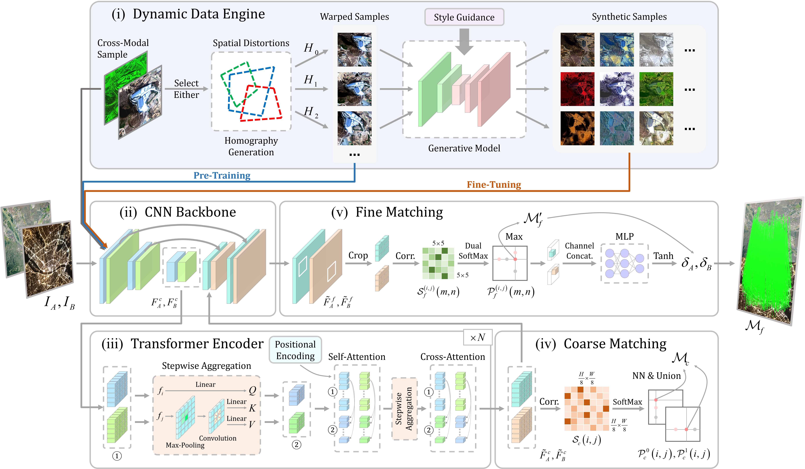

# DGIM: Cascaded Dynamic Data Generation for Robust Cross-Modal Image Matching

基于 [LotrL/DGIM](https://github.com/LotrL/DGIM) 的公开代码，增加集中路径配置，便于本地与 AutoDL 之间迁移。保留 Apache-2.0 LICENSE 和论文引用。当前版本 **v2**，修改记录见 [CHANGELOG.md](CHANGELOG.md)，版本号见 [VERSION](VERSION)。

仓库包含源码、59 张风格图、风格网络 `epoch5.pth`、示例图和架构图。BIT 数据需要单独上传；DGIM 匹配器权重需要从下方作者链接获取。

## 服务器更新代码

以后更新最新版始终使用这三行，**不需要修改版本号，也不要重新复制本机配置**：

```bash
cd /root/autodl-tmp/DGIM
git switch main
git pull --ff-only
```

如果服务器上改过源码，先保存这些修改再更新，不要强制覆盖。机器路径放在不上传的 `configs/paths.local.yml`，正常拉取不会覆盖它。

首次下载时执行：

```bash
cd /root/autodl-tmp
git clone https://github.com/JuzhengLiu/DGIM.git
cd DGIM
cp configs/paths.autodl.example.yml configs/paths.local.yml
```

`cp` 只在首次配置且没有本机配置时执行，然后按实际位置编辑 `configs/paths.local.yml`。将训练数据单独放到 `/root/autodl-tmp/BIT_training_dataset/`；`train_data_root` 应指向解压后下一层就是 `scene01` 等场景的目录。匹配器权重默认放在 `weights/dgim_512.ckpt`。

只有需要固定某个历史版本时，才在仓库目录执行下面两行，并把最后的 `v2` 换成所需版本：

```bash
git fetch --tags
git switch --detach v2
```

回到最新版时，使用本节开头的三行命令。`v1`、`v2` 等已发布标签保持不变；之后每次交付修改递增版本号，并在 CHANGELOG 中写简短说明。

## 修改路径

所有路径统一放在带注释的 [configs/paths.yml](configs/paths.yml) 中；机器差异只写入 `configs/paths.local.yml`，例如：

```yaml
paths:
  # 下一层应为 scene01 等场景目录
  train_data_root: /root/autodl-tmp/BIT_training_dataset/BIT_multi-modal_datasets_homography_30_rotation
  matcher_checkpoint: /root/autodl-tmp/DGIM/weights/dgim_512.ckpt
  log_dir: /root/autodl-tmp/DGIM_outputs/training
  demo_output_dir: /root/autodl-tmp/DGIM_outputs/matches
```

只需写要覆盖的键。切换 ±180° 数据只改 `train_data_root`。Windows 路径建议写作 `D:/datasets/...`。相对路径始终以仓库根目录为基准，支持 `~`、`$VAR`、`${VAR}`、`%VAR%`；环境变量需预先定义。模型超参数仍放在原有 Python 配置中。

默认读取 `paths.yml` 并叠加 `paths.local.yml`。如果指定 `--paths`，或未指定它但设置了 `DGIM_PATHS_CONFIG`，则用选中的 YML 文件覆盖默认配置，不再叠加本机文件。命令行路径也以仓库根目录为基准。未知配置键会报错。

**从 v1 升级：** 旧的 `configs/paths.local.json` 不再自动读取，请把原有路径手动转写为上述 YML 格式，保存为 `configs/paths.local.yml`。如果没有旧的本机覆盖配置，只需首次复制 AutoDL 示例。不要在每次拉取后执行 `cp`，以免覆盖自己的路径。

`pretrained_checkpoint` 用于初始化匹配器，`resume_checkpoint` 用于恢复 Lightning 训练状态；按需要择一配置。`style_checkpoint` 是随仓库提供的风格网络权重，不能代替 `matcher_checkpoint`。其他键的用途见 YML 内注释。YML 使用 PyYAML 的 `yaml.safe_load` 读取；PyYAML 也是原 YACS 的依赖，本次未安装环境。

数据、本机配置、日志、训练输出和缓存不上传；风格图、示例和现有风格权重继续受版本控制。

## 复现状态

本次只整理代码和配置，没有运行论文训练/推理、安装依赖或验证论文指标。依赖和权重准备好后，服务器演示可用 `python demo.py --no-show`，图片按文件名排序、每相邻两张组成一对，结果写入 `demo_output_dir`；GUI 演示需要桌面。

原始实现还有这些待核查问题：

- `fine_matching.py` 的 `get_fine_match` 使用 `torch.no_grad()`，亚像素 MLP 的训练梯度需要核查；`transfer_net.py` 第二组残差块返回值未赋回特征，修改前需确认作者权重对应的代码。
- 预训练日程与当前 Dataset 微调增强尚未构成完整两阶段流程，也没有完整论文指标评测入口；demo 的 MAGSAC 可视化不能代替定量评测。
- 依赖版本未锁定，训练使用旧版 PyTorch Lightning API；演示仍使用 CUDA 和半精度，训练的 `guidedFilter` 需要 OpenCV contrib 模块。

论文报告匹配器训练使用 RTX 4090D 24 GB，这不是本仓库已测得的最低要求。

## 论文与资源

[论文原文](https://ieeexplore.ieee.org/document/11213501)



| 资源 | Google Drive | 百度网盘 |
|---|---|---|
| 模型权重 | [下载](https://drive.google.com/drive/folders/1bpHc09QDIr3idgPMNupS30NeLzGuqjh-?usp=drive_link) | [下载，提取码 dgim](https://pan.baidu.com/s/14quWOrtOUOjgzJkAUzBsew?pwd=dgim) |
| 训练数据 | [下载](https://drive.google.com/drive/folders/1sMWudiDA2u7STSZuzm0Pg0IxtzNyYkeq?usp=sharing) | [下载，提取码 bit6](https://pan.baidu.com/s/1eZ3wjIBBCAs0FgGgvpniMA?pwd=bit6) |
| 测试数据 | [下载](https://drive.google.com/file/d/1cL0vBICIOQEPPJcJe7X89U4nRZWifRLU/view?usp=drive_link) | [下载，提取码 dgim](https://pan.baidu.com/s/13u5VHJXNHewwRtT8EburRA?pwd=dgim) |

```bibtex
@article{weng2025dgim,
  title={{DGIM}: Cascaded Dynamic Data Generation for Robust Cross-Modal Image Matching},
  author={Weng, Desheng and Li, Wei and Gao, Chenzhong and Xia, Xiang-Gen and Shi, Zhicheng and Cui, Bolun},
  journal={IEEE Transactions on Geoscience and Remote Sensing},
  year={2025},
  volume={63},
  pages={1-16},
  publisher={IEEE}
}
```
